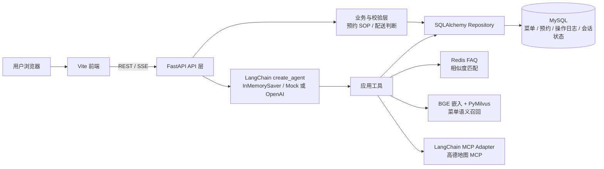

# 六合餐厅 LangChain Agent 项目设计

本项目根据 day11 同类课程项目的技术路线整理：Python 3.12 + uv、FastAPI、LangChain Agent、MySQL/SQLAlchemy、Redis FAQ、BGE-base-zh + PyMilvus、高德地图 MCP，以及独立 Vite 前端。前端完成菜单、口味推荐、预约、配送范围和 Agent 对话；服务端提供对应 API 和可靠的数据流程。

## 需求梳理与技术选型

| 需求 | 技术选型 | 选择原因与实现 |
| --- | --- | --- |
| 菜单展示、分类和供应事实 | FastAPI + SQLAlchemy + MySQL | 菜品价格、类别、风味、过敏原、特色标记和供应状态是结构化事实，适合关系表和条件查询；数据库由 `restaurant_app/database.py` 定义并初始化。 |
| 菜单语义检索、口味和特色推荐 | BGE-base-zh + LangChain HuggingFace + PyMilvus | 用中文向量召回用户自然语言里的菜品意图；Milvus 排序候选，MySQL 回查当前价格、标签和供应状态，避免向量文档被误当作实时事实。Milvus 使用远端 URI，不要求本机安装服务。 |
| 餐厅 FAQ | Redis + SequenceMatcher + Jaccard | FAQ 是短文本问答，Redis 便于低延迟存取；字符串相似度用于匹配口语化问法，低于阈值则明确返回未匹配，避免模型编造。 |
| Agent 意图处理与工具调用 | LangChain `create_agent` + LangGraph `InMemorySaver` | 将菜单、FAQ、配送和查单封装为工具，由 Agent 按工具结果组织回答；稳定 session/thread id 维持当前进程内的对话上下文。默认使用 LangChain mock chat model，不请求外部推理服务。 |
| 预约收集、确认和写库 | 服务端预约 SOP + MySQL + SQLAlchemy | 有副作用的预约不能由模型自行决定；应用层掌握确认状态，校验完整字段后才调用幂等写入。操作日志与预约状态用于超时核对和重启恢复。 |
| 地址解析和路线判断 | LangChain MCP Adapter + 高德地图 MCP | Adapter 发现地图服务工具并供 Agent 使用；应用流程组合地理编码、驾车/骑行路线或直线距离，服务故障与地址不存在分别处理。 |
| 用户交互 | Vite + 原生 JavaScript | 课程使用独立前端开发服务器；Vite 将 `/api` 代理至 FastAPI。对话使用 SSE 逐段展示。 |
| API 与输入校验 | FastAPI + Pydantic | REST 接口、请求模型、字段长度、人数范围和枚举值集中校验，接口文档从 `/doc` 访问。 |

依赖版本写入 `pyproject.toml` 和 `frontend/package.json`。实现阶段没有安装依赖、生成锁文件、下载模型或启动 MySQL、Redis、Milvus。

## 功能到数据流

| 功能 | SOP 数据流 | 长尾和异常处理 |
| --- | --- | --- |
| 菜单和菜品查询 | 前端调用 `/api/menu` 或 Agent 的 `check_menu_item`；MySQL 返回权威记录。 | 无记录返回 `not_found`；售罄仍展示真实状态；MySQL 不可用返回服务错误，不伪装成空菜单。 |
| 语义搜索与推荐 | 把菜名、类别、描述、口味和过敏原组合为菜单文本；BGE 编码；写入/更新远端 Milvus；根据输入向量搜索；以 MySQL 菜单事实重排/补全。 | Milvus 未配置、BGE 文件缺失或服务故障会显式失败；应用不使用 hash 向量、本地 Milvus 或模型自动下载作为替代。若 Milvus 返回已下架或不存在的菜名，MySQL 回查后过滤。 |
| FAQ | 应用把问题规范化；遍历 Redis FAQ 问句；计算 SequenceMatcher 与 Jaccard 加权分；按阈值返回最匹配答案。 | Redis 故障与“没有匹配 FAQ”分开处理；低分时说明暂时没找到，不让模型补造事实。 |
| 配送查询 | 校验地址和出行方式；高德 MCP 解析经纬度；直线模式调用距离工具，驾车/骑行调用路线工具；服务端把距离与半径比较。 | 地址未解析返回可重试的输入提示；MCP 不可用、工具缺失、响应缺少距离则返回 503；直线距离不展示行程分钟数；Demo 坐标明确标为演示数据。 |
| 预订创建 | 意向触发草稿；抽取八项资料；追问缺失字段；校验；完整复述；明确确认；持久化 PENDING 操作；写预约并提交 SUCCEEDED 和事件。 | 日期无效或已过期、人数不合法、儿童多于总人数、电话格式不合格时继续询问；用户可修改或取消；相同 request_id 与内容重放返回原记录；内容冲突返回 409；写入不确定时保留 pending 状态，以原编号核对/恢复。 |
| 预订查询 | 按预订编号、手机号或当前会话查 MySQL；列表强制使用手机号或 thread id 过滤。 | 没有匹配时才报告无记录；数据库无法读取时报告查询失败；不会不加条件返回全部客户记录。 |
| 流式聊天 | Vite 以 POST 请求 `/api/chat/stream`；FastAPI 使用 Agent 的 message stream 输出 SSE；浏览器逐 token 更新当前消息。 | SSE 遇到 Agent 或工具异常时发送 error event；前端提示可重试，不把中断响应显示成成功操作。 |

## 核心预订 SOP

```text
用户提出预订
  → 生成稳定 request_id 并保存 MySQL chat_sessions
  → 逐轮补齐姓名、电话、人数、儿童数、到店时间、座位、主菜偏好、备注
  → 参数校验并处理歧义
  → 服务端复述完整摘要
  → 用户明确确认？ ─ 否 → 继续修改 / 取消 / 等待
                    └ 是 → 保存 agent_operations(PENDING)
                         → 同 request_id 写入 reservations
                         → 标记 SUCCEEDED、写事件日志并返回预订编号
  → 遇到超时或重启：按原 request_id 查询/恢复，禁止另起编号重复写入
```

Agent 的 `create_reservation` 工具需要应用上下文中的 `confirmed_reservation`；普通模型对话没有这个上下文。网站预约表单也必须将 `confirmed=true` 传入 API。预订写入不依据模型生成的“已经确认”文本，而依据服务端确认状态。

## 运行配置边界

- MySQL：`.env` 使用 `MYSQL_HOST`、`MYSQL_PORT`、`MYSQL_USER`、`MYSQL_PASSWORD`、`MYSQL_DATABASE`，也可使用 `MYSQL_URL`。数据库需预先创建，应用建立表并填充空菜单表。
- Redis：使用 `REDIS_URL` 和 `REDIS_FAQ_PREFIX`；启动时检查连接并补齐演示 FAQ。
- Milvus：只配置 `MILVUS_URI`、`MILVUS_TOKEN`、`MILVUS_COLLECTION` 指向远端服务；不包含本地 Milvus 部署流程。
- BGE：`EMBEDDING_MODEL_PATH` 指向已存在的本地模型目录；`HF_HUB_OFFLINE` 和 `TRANSFORMERS_OFFLINE` 禁止下载。
- Agent：默认 `AGENT_PROVIDER=mock`，mock 仍走 LangChain agent graph 和工具调用；要使用真实模型时配置 `AGENT_PROVIDER=openai`、`OPENAI_API_KEY` 和 `OPENAI_MODEL`。
- 地图：`AMAP_MCP_URL`、`AMAP_MCP_TRANSPORT` 配置 MCP Adapter；可选择 `http` 或 `sse` transport。未配置时可用明确标记的 Demo provider。
- 前端：`frontend/` 的 Vite 默认端口 3000，FastAPI 默认 8000；开发模式代理 API 与文档请求。

API 文档由 FastAPI 提供于 `/doc`。完整目录结构和运行方式见 [README.md](README.md)。

## 验收标准

1. **菜单与推荐**：菜单可按分类、口味和关键词查询；特色菜与口味推荐使用 BGE + Milvus 检索，并用 MySQL 核验价格和供应状态，不把售罄菜品标记为可预订。
2. **语义搜索**：输入自然语言后返回相关菜品；Milvus 或嵌入模型不可用时明确返回服务错误，不切换为伪向量结果。
3. **常见问题**：Redis FAQ 返回达到相似度阈值的答案；低于阈值时告知未匹配，Redis 故障与未命中能够区分。
4. **预约**：姓名、电话、人数、儿童数、到店时间、座位偏好、主菜偏好和备注齐全且校验通过后，服务端复述并取得明确确认，才写入 MySQL；重复请求不重复创建，冲突请求返回错误。
5. **配送范围**：`POST /api/delivery` 接受地址及出行方式 1/2/3，完成地址解析与距离计算，并按 5 公里判断；地址无法解析与地图服务故障返回不同结果。
6. **Agent 与交互**：菜单、FAQ、查单和配送通过 LangChain Agent 工具处理；聊天支持普通响应和 SSE 流式响应，工具异常会明确提示。
7. **数据边界**：MySQL 是菜单及预约事实来源，Redis 保存 FAQ，Milvus 只负责语义召回；查单必须按预约编号、手机号或会话过滤，不泄露全部预约。
8. **配置与文档**：依赖和外部服务配置有明确说明，API 文档可从 `/doc` 查看；默认 mock 模型不需要真实模型密钥。验收运行前需由部署环境提供 MySQL、Redis、远端 Milvus 和 BGE 模型路径；本次整理不安装依赖或启动这些服务。

## 系统设计

### 架构分层



### 核心设计约束

- **职责分离**：前端负责展示与输入；FastAPI/Pydantic 负责接口、校验和错误映射；Repository 负责 MySQL 读写；Agent 通过工具调用业务能力，不直接绕过业务流程写预约。
- **事实与召回分离**：MySQL 保存权威菜单和预约数据；BGE + Milvus 只返回语义候选，候选菜品再回查 MySQL，过滤下架或售罄项。
- **预约有确认门槛**：按“收集—校验—摘要—确认—幂等写入”执行。`request_id` 关联操作记录与预约；超时或重启后按原请求核对待处理状态，避免重复建单。
- **外部服务可替换**：地图通过 Provider 接口封装，配置后接高德 MCP；无配置时使用明确标识的 Demo provider。模型默认使用 LangChain mock，配置后可切换 ChatOpenAI；Redis、MySQL、Milvus 通过环境变量连接。
- **异常按来源反馈**：参数错误由 Pydantic 返回；地址不存在提示用户修正；外部服务不可用返回服务错误；FAQ 未命中、预约冲突和数据读取故障分别处理，不将异常伪装成空结果或成功操作。
